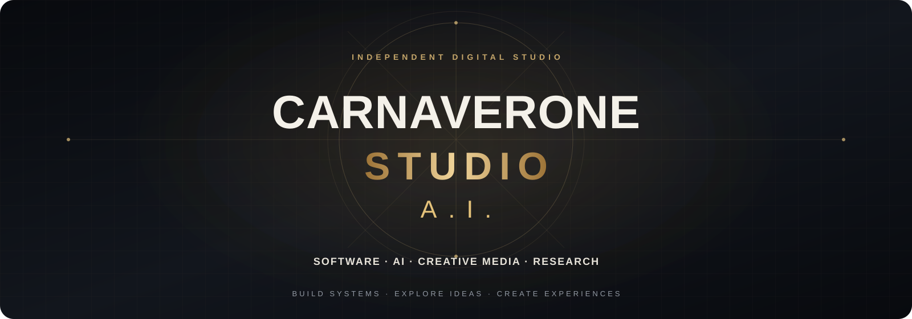

  

  <strong>Multimodal AI Creative Studio</strong> 
  AI agents · Video · Image · Music · Software · Workflows

  <em>Architects of Synthetic Reality &amp; Agentic Systems.</em>

  
  
  
  

  <strong>AGENTIC SYSTEMS &amp; ORCHESTRATION</strong> 
  
  
  
  
  
  

  <strong>MULTIMODAL CREATIVE PRODUCTION</strong> 
  
  
  
  
  
  

---

## 01 / THE STUDIO

Carnaverone Studio A.I. is an independent multimodal creative technology studio working at the intersection of artificial intelligence, agentic systems, software engineering and digital media.

The studio develops and explores AI agents, multi-agent coordination, swarm architectures, intelligent workflows and local-first tools — alongside original production in image, video, music, audio and interactive media.

**From agentic systems to synthetic realities: research, engineering and creative production under one studio.**

---

## 02 / CORE DIVISIONS

<table>
  <tr>
    <td width="50%" valign="top">
      <h3>◈ Agentic Systems</h3>
      AI agents, multi-agent architectures, swarm coordination, orchestration, MCP integrations and autonomous workflow experiments.
        
      AGENTS · SWARM · ORCHESTRATION · MCP · AUTOMATION
    </td>
    <td width="50%" valign="top">
      <h3>✳ Multimodal Creative Lab</h3>
      AI-assisted image creation, video production, motion, music, audio, narration, avatars and visual storytelling.
        
      IMAGE · VIDEO · MUSIC · AUDIO · AVATARS
    </td>
  </tr>
  <tr>
    <td width="50%" valign="top">
      <h3>⌘ Software &amp; Infrastructure</h3>
      Applications, developer tools, interfaces, Linux environments, local AI infrastructure, integrations and reusable components.
        
      SOFTWARE · LINUX · LOCAL AI · SYSTEMS
    </td>
    <td width="50%" valign="top">
      <h3>⌬ Research &amp; Development</h3>
      Prototypes, benchmarks, technical investigations, documentation, open-source resources and experimental architectures.
        
      R&amp;D · PROTOTYPES · BENCHMARKS · OPEN SOURCE
    </td>
  </tr>
</table>

---

## 03 / PEOPLE &amp; CREATIVE PROFILES

<table>
  <tr>
    <td width="116" align="center" valign="middle">
      
    </td>
    <td valign="middle">
      <h3><a href="https://github.com/carnaverone">CARNAVERONE</a></h3>
      <strong>Founder · Studio Direction · Software · Agentic Systems · R&amp;D</strong> 
      Systems architecture, AI agents, local AI, software development, multimodal workflows and multidisciplinary creative direction.
        
      <a href="https://www.carnaverone.com">Website</a> ·
      <a href="https://github.com/carnaverone">GitHub</a> ·
      <a href="https://linktr.ee/Carnaverone">Linktree</a>
    </td>
  </tr>
  <tr>
    <td width="116" align="center" valign="middle">
      
    </td>
    <td valign="middle">
      <h3><a href="https://github.com/dazmelania">DAZMELANIA</a></h3>
      <strong>Digital Artist · AI Video Creator · Visual Storytelling</strong> 
      Short-form comedy, AI-assisted characters and visual art, mischievous animals, quirky companions, Canadian seasonal humour, mini-sketches and imaginative everyday stories.
        
      <a href="https://github.com/dazmelania">GitHub</a> ·
      <a href="https://github.com/dazmelania/dazmelania">Creator profile</a> ·
      <a href="https://linktr.ee/dazmelania">Linktree</a>
       
      <a href="https://www.youtube.com/channel/UC8XpagCvXHcnrHl-WEx5ISw">YouTube</a> ·
      <a href="https://www.facebook.com/dazmelania">Facebook</a> ·
      <a href="https://www.tiktok.com/@dazmelania">TikTok</a>
    </td>
  </tr>
</table>

---

## 04 / EXPLORE &amp; FOLLOW

  
  

  <a href="https://linktr.ee/Carnaverone">Carnaverone · All links</a>
  &nbsp; / &nbsp;
  <a href="https://linktr.ee/dazmelania">Dazmelania · All links</a>
  &nbsp; / &nbsp;
  <a href="https://www.youtube.com/channel/UC8XpagCvXHcnrHl-WEx5ISw">Dazmelania · YouTube</a>

<strong>FRANÇAIS — Présentation du studio</strong>

## 01 / LE STUDIO

Carnaverone Studio A.I. est un studio créatif multimodal indépendant, à la croisée de l'intelligence artificielle, des systèmes agentiques, du développement logiciel et des médias numériques.

Le studio conçoit et explore les agents IA, les architectures multi-agents, la coordination en essaim (Swarm), l'orchestration et les workflows intelligents — en parallèle de productions originales en image, vidéo, musique, audio et médias interactifs.

**Des systèmes agentiques aux réalités synthétiques : recherche, ingénierie et création sous un même studio.**

## 02 / NOS PÔLES

- **Systèmes agentiques** — agents IA, architectures multi-agents, coordination Swarm, orchestration, intégrations MCP et workflows automatisés.
- **Laboratoire créatif multimodal** — création d'images assistée par IA, vidéo, motion, musique, audio, narration, avatars et récits visuels.
- **Logiciels et infrastructure** — applications, outils de développement, interfaces, environnements Linux, IA locale, intégrations et composants réutilisables.
- **Recherche et développement** — prototypes, benchmarks, recherches techniques, documentation, ressources open source et architectures expérimentales.

## 03 / MEMBRES & PROFILS CRÉATIFS

**[Carnaverone](https://github.com/carnaverone)** — Fondateur · Direction du studio · Logiciels · Systèmes agentiques · R&D. Architecture de systèmes, agents IA, IA locale, développement logiciel, workflows multimodaux et direction créative. [Site](https://www.carnaverone.com) · [GitHub](https://github.com/carnaverone) · [Linktree](https://linktr.ee/Carnaverone).

**[Dazmelania](https://github.com/dazmelania)** — Artiste numérique · Créatrice vidéo IA · Narration visuelle. Humour court, personnages assistés par IA, animaux malicieux, compagnons décalés, humour saisonnier canadien, mini-sketches et histoires imaginatives du quotidien. [GitHub](https://github.com/dazmelania) · [Linktree](https://linktr.ee/dazmelania) · [YouTube](https://www.youtube.com/channel/UC8XpagCvXHcnrHl-WEx5ISw) · [Facebook](https://www.facebook.com/dazmelania) · [TikTok](https://www.tiktok.com/@dazmelania).

## 04 / EXPLORER & SUIVRE

- [Tous les projets GitHub](https://github.com/orgs/carnaverone-studio-a-i/repositories)
- [Site officiel](https://www.carnaverone.com)
- [Liens Carnaverone](https://linktr.ee/Carnaverone)
- [Liens Dazmelania](https://linktr.ee/dazmelania)
- [Chaîne YouTube Dazmelania](https://www.youtube.com/channel/UC8XpagCvXHcnrHl-WEx5ISw)

---

© Carnaverone Studio A.I. · Project licenses and terms remain defined in each repository.
